<h1 align="center">Alex Alonso</h1>

  Backend engineer at <b>Getnet</b> · building products at <b>AlherTech</b>
   
  <a href="https://linkedin.com/in/alex28042">LinkedIn</a> ·
  <a href="https://alhertech.com">alhertech.com</a> ·
  <a href="https://www.npmjs.com/~alex28042">npm</a>

 

<!-- claude-code:start -->

<!-- claude-code:end -->
